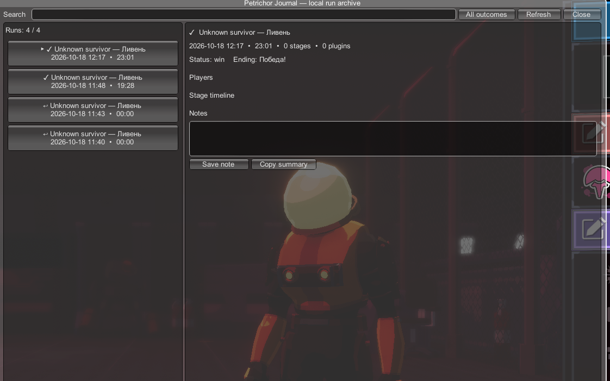
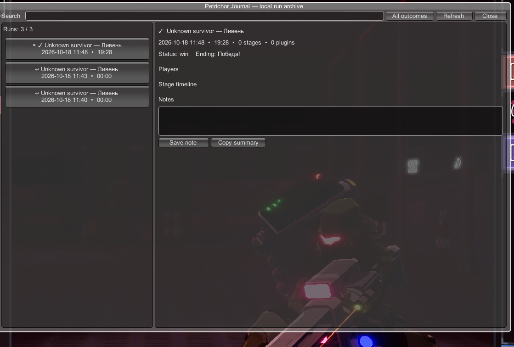

<p align="center">
  
</p>

<h1 align="center">Petrichor Journal</h1>

<p align="center">
  A private, crash-resistant run archive for Risk of Rain 2.<br>
  Record the story of a run locally: stages, builds, item changes, deaths, players, and loaded mods.
</p>

<p align="center">
  <strong>Version 0.1.3 beta</strong> · <a href="README.ru.md">Русское описание</a> · MIT License
</p>

## Overview

Risk of Rain 2's result screen is useful, but it does not answer many questions players ask after a run: *When did the build change? What did I carry into each stage? What dealt the killing blow? Which mods were loaded?*

Petrichor Journal keeps a separate local archive without modifying the vanilla profile or run history. Each run is saved as a human-readable JSON document and can be browsed from an in-game window.





## Features

### Run archive

- One independent JSON report per run.
- Atomic autosaves while a run is active.
- Interrupted and abandoned runs remain visible after a crash or early exit.
- Search by survivor, stage, item, outcome, note, plugin name, plugin GUID, or plugin version.
- Outcome filters for wins and non-wins.
- Per-run notes and a copyable text summary.

### Stage and build history

- Records every client-side scene entered during an active run.
- Stores entry and exit times for each stage.
- Captures survivor level, health, shield, regeneration, armor, damage, attack speed, critical chance, and movement speed.
- Saves the complete local inventory snapshot for every stage.
- Uses both stable internal item names and localized display names, including modded items.

### Item timeline

- Records local-player item gains and losses.
- Stores run time, stage number, delta, and resulting stack count.
- Keeps the complete timeline in JSON; the in-game window shows the latest changes.

### Results and deaths

- Imports the final `RunReport` statistics for every player.
- Records damage dealt and taken, healing, kills, elite and minion kills, deaths, highest hit, gold, purchases, distance, drones, and turrets.
- Stores final inventories and equipment.
- Records the local player's killing blow, attacker, final damage, and damage flags when available.

### Mod awareness

- Stores every loaded BepInEx plugin's name, GUID, and version.
- Makes vanilla-like and heavily modded runs distinguishable during later analysis.
- Modded items are stored by name rather than unstable numeric catalog indices.

### Privacy and safety

- No account, server, telemetry, analytics, or upload code.
- Multiplayer display names are replaced with `Player 1`, `Player 2`, and so on by default.
- Writes only to its own directory under `BepInEx/config/PetrichorJournal`.
- Does not modify balance, RNG, achievements, unlocks, saves, profiles, or the vanilla run-history limit.
- Recorder callbacks fail closed: a journal error disables that recorder for the session instead of interrupting game logic.

## Installation

### Mod manager

1. Download `PetrichorJournal_0.1.3.zip` from [GitHub Releases](https://github.com/wexaaa/PetrichorJournal/releases).
2. In r2modman or Thunderstore Mod Manager, open **Settings → Import local mod**.
3. Select the downloaded ZIP and launch the modded game.

### Manual

1. Install BepInEx 5.4 for Risk of Rain 2.
2. Create `BepInEx/plugins/PetrichorJournal/` inside the game directory.
3. Copy `PetrichorJournal.dll` into that directory.

## Usage

- Press **F8** to open or close the journal.
- Press **Escape** to close the window.
- Select a run on the left to inspect its details.
- Use the search field and outcome filter at the top.
- Notes are stored inside the selected run's JSON file.

The key and recording options are available in:

```text
BepInEx/config/com.petrichorjournal.core.cfg
```

## Configuration

| Setting | Default | Purpose |
| --- | --- | --- |
| Open Journal | `F8` | Opens the archive window |
| Autosave interval seconds | `10` | Flush interval after recorded changes; minimum 2 seconds |
| Record loaded mods | `true` | Saves plugin names, GUIDs, and versions |
| Record item timeline | `true` | Saves local inventory gains and losses |
| Redact player names | `true` | Replaces multiplayer names with numbered labels |

## Data location

```text
BepInEx/config/PetrichorJournal/archive/<run-id>.json
```

The current format is schema version 2. Removing the mod does not remove reports. Deleting a report file removes only that journal entry.

## Compatibility

- Risk of Rain 2 `1.5.0` / Hallowed Concepts-era build.
- Unity `2021.3.45`.
- BepInEx `5.4.21` or the current RoR2 BepInEx pack.
- Client-side: other players do not need the mod for final multiplayer summaries to be recorded locally.

## Known limitations

- This is a beta release using an IMGUI window rather than native Logbook UI.
- The item timeline follows the local player; final summaries include all players available in the game's final report.
- Death capture stores the killing blow, not the complete recent damage history.
- Reports created by versions 0.1.0–0.1.2 may contain only basic metadata because those versions used Unity's serializer, which discarded nested collections. Missing historical data cannot be reconstructed.
- Controller-first navigation and full localization are not implemented yet.

## Building from source

Requirements: .NET SDK 8 or newer.

```powershell
dotnet restore src/PetrichorJournal/PetrichorJournal.csproj
dotnet build src/PetrichorJournal/PetrichorJournal.csproj -c Release --no-restore
```

The assembly is written to:

```text
src/PetrichorJournal/bin/Release/netstandard2.1/PetrichorJournal.dll
```

Dependencies are compile-time packages only; Petrichor Journal does not require R2API or an external JSON library at runtime.

## Roadmap

- Side-by-side run comparison and graphs.
- Optional import of vanilla `RunReports`.
- Per-stage combat-stat deltas.
- QoL-only versus gameplay-changing mod-profile tags.
- Native Logbook integration and controller navigation.
- Additional localizations.

## Contributing

Bug reports should include the Petrichor Journal version, game version, reproduction steps, and the relevant excerpt from `BepInEx/LogOutput.log`. See [CONTRIBUTING.md](CONTRIBUTING.md).

## License and disclaimer

Released under the [MIT License](LICENSE).

Petrichor Journal is an independent community project. It is not affiliated with Hopoo Games, Gearbox Publishing, or Valve. Risk of Rain and Risk of Rain 2 are trademarks of their respective owners.
